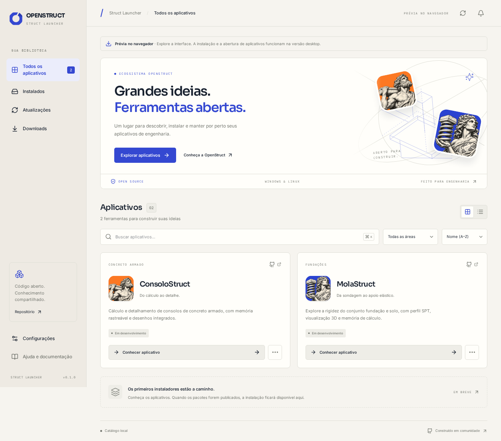

<div align="center">


# Struct Launcher

**Grandes ideias. Ferramentas abertas.**

Seus aplicativos de engenharia, juntos em um só lugar.

[](https://github.com/ricardocorsini/launcher-struct/actions/workflows/ci.yml)
[](LICENSE)
[](CHANGELOG.md)

Parte do ecossistema **OpenStruct** · Engenharia estrutural aberta

[Executar](#executar) · [Documentação](#documentação) · [Contribuir](CONTRIBUTING.md)

</div>



## O projeto

Struct Launcher é um aplicativo desktop para **Windows e Linux** que reúne o catálogo dos produtos OpenStruct e seu gerenciamento local: download, instalação, abertura, atualização e desinstalação. Cada produto continua sendo um aplicativo independente.

A interface usa a identidade OpenStruct: cobalto `#3448D1`, marfim, Sora, Inter, IBM Plex Mono e os ícones originais de ConsoloStruct e MolaStruct.

## Estado desta versão

**v0.1.0 — primeira implementação.** O catálogo incluído apresenta os dois produtos, com informações e documentação. **Os instaladores desses produtos e a fonte online ainda não foram publicados/configurados.** Por isso, eles aparecem como “Em desenvolvimento”: não há downloads fictícios, versões instaladas simuladas ou botão de instalação que apenas reproduza uma animação.

O gerenciador nativo e os adaptadores NSIS/AppImage estão implementados. A publicação posterior precisa incluir os pacotes reais e as chaves públicas em `catalog/trust.json`. O launcher não aceita um pacote sem origem autorizada, metadados válidos e assinatura reconhecida. A atualização do próprio launcher também fica desativada até a configuração do endpoint e da chave próprios.

Veja [VALIDACAO.md](docs/VALIDACAO.md) para as verificações feitas e os limites. Compilar a aplicação não substitui validar seus instaladores nos sistemas de destino.

## Recursos

- Biblioteca em grade e lista, busca sem distinção de acentos, filtros por área e ordenação.
- Detalhes de produto, recursos, requisitos, versões e links oficiais.
- Temas claro, escuro e do sistema; interface em português e inglês. O conteúdo editorial do catálogo permanece em português.
- Catálogo incluído, catálogo remoto assinado e cache verificado para uso sem conexão.
- Seleção de pacote por sistema, arquitetura, canal e versão mínima do launcher.
- Fila sequencial, progresso real em bytes, cancelamento, nova tentativa e histórico persistente.
- Verificação de tamanho, SHA-256 e assinatura Ed25519 antes da execução de pacotes.
- Windows: instalador NSIS por usuário, confirmação de resultado e desinstalador nativo.
- Linux: instalação AppImage por versão, troca após verificação, atalho e remoção gerenciada.
- Inventário local, detecção de executáveis ausentes/alterados e recuperação de operações interrompidas.
- Atualizações iniciadas pelo usuário, verificação dos aplicativos em execução e confirmação para versões anteriores.
- Projetos separados dos executáveis; desinstalação remove somente a instalação gerenciada.

## Executar

### Interface no navegador

Requisitos: **Node.js 22.12+** e npm. Recomenda-se usar a versão de `.nvmrc`.

```sh
git clone https://github.com/ricardocorsini/launcher-struct.git
cd launcher-struct
npm ci
npm run dev
```

Abra **http://127.0.0.1:1420**. A interface no navegador é uma prévia: permite explorar catálogo, detalhes, temas, idioma, busca e preferências visuais. Operações de instalação e abertura de executáveis exigem o aplicativo desktop. A prévia não simula instalações no navegador.

### Aplicativo desktop

Além de Node, instale **Rust estável** e os [pré-requisitos do Tauri](https://v2.tauri.app/start/prerequisites/) para seu sistema. Consulte [INSTALACAO.md](docs/INSTALACAO.md).

```sh
npm ci
npm run desktop:dev
```

Para gerar pacotes no sistema atual:

```sh
npm run desktop:build
```

Os resultados ficam em `target/release/bundle/` porque o projeto usa um workspace Cargo. No Windows, a configuração prioriza NSIS; no Linux, AppImage e Debian. A instalação do launcher por `.deb` é independente do formato AppImage usado por ele para gerenciar seus produtos. Não substituir arquivos de um launcher instalado por um gerenciador de sistema com outro formato de atualização.

O workflow manual [Desktop](.github/workflows/desktop.yml) compila em runners Windows e Ubuntu, gerando arquivos para validação em **Actions → Desktop packages**. Ele não cria releases nem publica automaticamente o catálogo.

## Desenvolvimento

```sh
npm run check           # TypeScript, domínio, scripts de assinatura e catálogo
npm run build           # Build web de produção
npm run format:check    # Formatação JS/TS/JSON/Markdown/YAML
cargo fmt --all --check
cargo test -p launcher-core --locked
cargo clippy -p launcher-core --all-targets --locked -- -D warnings
```

Testes de navegação:

```sh
npx playwright install chromium-headless-shell
npm run test:e2e
```

Em uma instalação Linux mínima, os navegadores de teste podem precisar das dependências indicadas pelo Playwright. Os testes Rust de transferência usam um servidor HTTP apenas de loopback. O caminho de produção valida HTTPS e as origens autorizadas antes da transferência.

## Arquitetura

**Tauri 2 · Rust · React · TypeScript · Vite · Tailwind CSS**

| Caminho                 | Responsabilidade                                                                |
| ----------------------- | ------------------------------------------------------------------------------- |
| `src/`                  | Interface, preferências, detalhes e acompanhamento de operações                 |
| `crates/launcher-core/` | Catálogo, assinaturas, transferência, fila, inventário e adaptadores            |
| `src-tauri/`            | Janela, comandos restritos, eventos, diálogo de pasta e atualização do launcher |
| `catalog/`              | Catálogo inicial e configuração de confiança pública                            |
| `scripts/`              | Validação, geração de chaves e assinatura para publicação futura                |
| `tests/`                | Domínio, navegação e vetor de assinatura compartilhado Node/Rust                |
| `docs/`                 | Instalação, operação, arquitetura, validação e distribuição                     |

O frontend solicita operações por ID e versão. Não fornece linhas de shell, caminhos de executáveis ou URLs de instaladores ao backend. Chaves públicas e origens autorizadas são compiladas no launcher. As chaves privadas não fazem parte do produto.

## Distribuição futura

O contrato e as ferramentas estão preparados em [CATALOGO.md](docs/CATALOGO.md). O roteiro técnico está em [DISTRIBUICAO.md](docs/DISTRIBUICAO.md). A configuração e a publicação efetivas de GitHub Releases são uma etapa posterior.

Para downloads sem login, o catálogo e os pacotes precisam estar acessíveis publicamente. Não inclua tokens do GitHub no binário. O status de visibilidade do repositório de desenvolvimento não é alterado por este projeto.

## Documentação

- [Instalação e compilação](docs/INSTALACAO.md)
- [Guia de uso](docs/GUIA-DE-USO.md)
- [Arquitetura e limites de confiança](docs/ARQUITETURA.md)
- [Contrato do catálogo e assinaturas](docs/CATALOGO.md)
- [Preparação da distribuição](docs/DISTRIBUICAO.md)
- [Validação e limites](docs/VALIDACAO.md)
- [Recuperação e diagnóstico](docs/TROUBLESHOOTING.md)

## Contribuição

Issues, melhorias de código, documentação e testes são bem-vindos. Leia [CONTRIBUTING.md](CONTRIBUTING.md). Relate vulnerabilidades conforme [SECURITY.md](SECURITY.md), sem publicar dados privados ou arquivos de projeto de clientes.

## Licença e créditos

[MIT](LICENSE). Desenvolvido por **Ricardo Corsini e colaboradores**, no ecossistema OpenStruct. As ilustrações de Atlas e da Terra foram criadas para a OpenStruct com geração de imagem. As referências ArtCraft orientaram a discussão de funcionalidades; a interface, os componentes e os recursos deste repositório foram elaborados para a OpenStruct.

Fontes e dependências mantêm suas próprias licenças. Os avisos das dependências da interface estão em [THIRD_PARTY_NOTICES.txt](public/THIRD_PARTY_NOTICES.txt).
